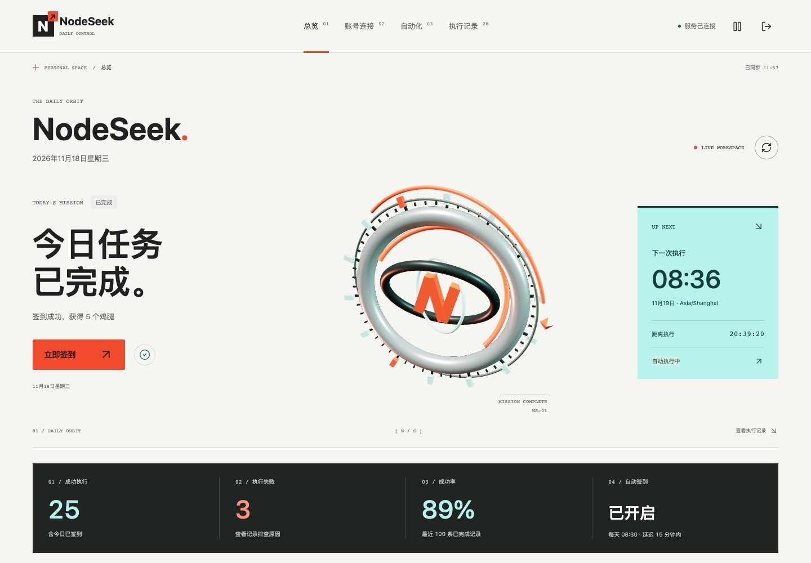
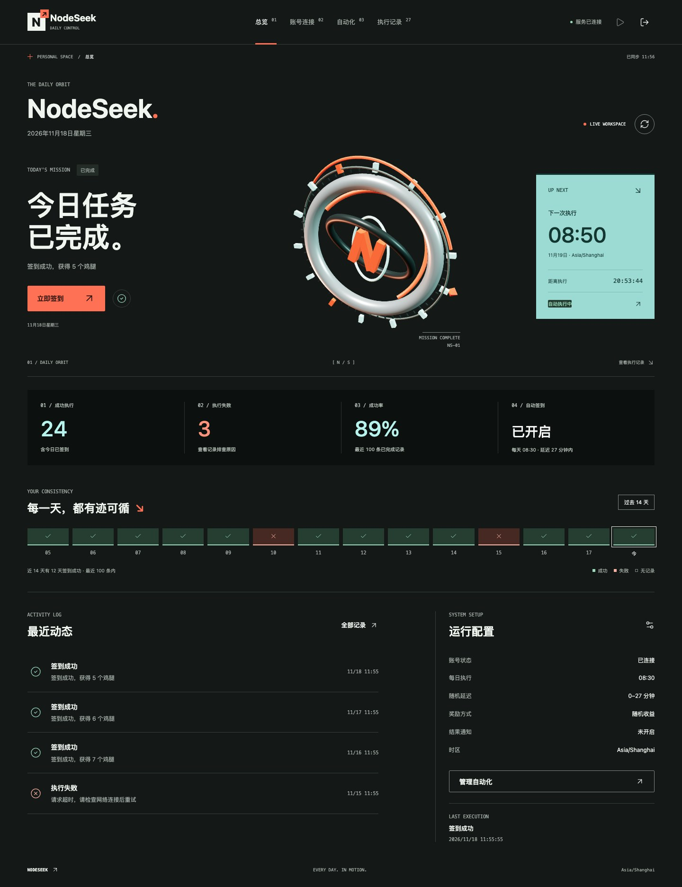

# NodeSeek Panel

一个容器完成 NodeSeek 每日签到、网页管理和可视化登录。支持手动粘贴 Cookie，或在容器浏览器里亲自登录后自动导入 Cookie 与 User-Agent。

- 动态控制台：顶部导航、开放式 3D 轨道、朱红与冰青配色；独立的总览、账号连接、自动化与执行记录视图，手机底部导航，支持浅色 / 深色 / 跟随系统。
- 总览展示今日结果、下次执行倒计时、近 14 天签到足迹与最近动态；每日定时、随机延迟、随机/固定奖励、立即签到。
- 两种登录方式：传统 Cookie 填写；内置 Chromium + noVNC 可视化登录，无需复制 Cookie。
- Bark 结果通知，可选仅在签到失败时发送；最近 100 条可见记录支持搜索、状态筛选、分页与 CSV 导出，最多保留 1,000 条。
- `/data` 持久化配置、任务计划、执行记录和登录密钥；重启不丢配置。
- 一个容器、一个对外端口 `8080`，不需要 Redis、数据库容器或独立浏览器服务。
- `linux/amd64` / `linux/arm64` 镜像，适用于常见服务器、NAS 和 Apple Silicon。

镜像：`ghcr.io/dongbo501/nodeseek-panel:latest`

源码：[dongbo501/nodeseek-panel](https://github.com/dongbo501/nodeseek-panel)



[查看完整总览](docs/panel-preview.jpg)

## 工作台

- **总览**：3D 轨道响应签到状态和鼠标，14 个轨道标记映射近 14 天结果；今日签到、下次执行倒计时、成功 / 失败数量、签到足迹和最近动态均使用真实接口数据，统计基于最近 100 条记录。
- **动效控制**：顶部按钮可暂停并记住偏好；遵循系统“减少动态效果”，切页、移出视口或隐藏标签页后停止渲染。不支持 WebGL 时显示静态轨道，签到操作保持可用。
- **账号连接**：手动填写 Cookie 或浏览器登录；账号凭据和自动化设置分别保存，切换视图保留草稿。
- **自动化**：执行计划、奖励方式、Bark 通知；修改后可保存或撤销。外观主题支持浅色、深色和跟随系统。
- **执行记录**：搜索、状态筛选、分页、展开完整结果以及 CSV 导出。手机端自动切换为带字段名称的纵向记录。



以上预览使用隔离的模拟数据。

## 快速部署

需要 Docker Engine 和 Docker Compose v2。建议至少 1 GB 可用内存；打开浏览器时建议预留 2 GB。内置浏览器会使镜像明显大于纯 Python 镜像，但仅在登录期间启动浏览器进程。

```bash
git clone https://github.com/dongbo501/nodeseek-panel.git
cd nodeseek-panel
cp .env.example .env
```

编辑 `.env`，设置自己的管理密码（至少 12 位）：

```dotenv
ADMIN_PASSWORD=这里替换为至少12位的独立强密码
BIND_ADDRESS=127.0.0.1
PORT=8080
COOKIE_SECURE=false
HOST_DNS=172.17.0.1
```

容器默认把 DNS 请求交给宿主机的 `172.17.0.1`（常见 Linux Docker 网桥地址）。宿主机需在该地址的 TCP/UDP 53 端口提供 DNS 服务；使用自定义网桥、Docker Desktop 或 OrbStack 时，请将 `HOST_DNS` 改为容器可访问且提供 DNS 服务的宿主机 IP。详见 [宿主机 DNS 配置](docs/DEPLOY.md#宿主机-dns)。

```bash
docker compose pull
docker compose up -d
```

访问 [http://127.0.0.1:8080](http://127.0.0.1:8080)，使用 `.env` 中的密码登录。默认只允许本机访问。远程服务器可使用 SSH 转发：

```bash
ssh -L 8080:127.0.0.1:8080 user@your-server
```

然后在自己的电脑打开同一地址。需要局域网访问时，将 `BIND_ADDRESS` 改成 `0.0.0.0` 并重新 `docker compose up -d`，通过 `http://服务器IP:8080` 访问；公网请配合 HTTPS 反向代理和防火墙，配置示例见 [部署教程](docs/DEPLOY.md)。

### 不使用 Compose

```bash
docker run -d --name nodeseek-panel --restart unless-stopped \
  -p 127.0.0.1:8080:8080 \
  --dns 172.17.0.1 \
  --shm-size=512m \
  --cap-drop=ALL --security-opt=no-new-privileges:true \
  -v nodeseek-data:/data \
  ghcr.io/dongbo501/nodeseek-panel:latest

docker logs nodeseek-panel
```

`--dns` 请按宿主机实际 DNS 地址调整；`docker run --env-file .env` 不会自动应用 `HOST_DNS`，必须显式传入 `--dns`。

未设置 `ADMIN_PASSWORD` 时首次启动自动生成管理密码，仅在容器日志中显示一次，密码哈希保存在数据卷中。也可以使用 `--env-file .env` 指定密码。管理员密码与 NodeSeek 账号密码相互独立。

## 配置账号：两种方式

### 方式一：从已有浏览器复制 Cookie

1. 在自己的浏览器中登录 [NodeSeek](https://www.nodeseek.com)。
2. 打开开发者工具（通常是 F12），进入 **Network / 网络**。
3. 刷新页面，选择发往 `www.nodeseek.com` 的请求。
4. 在 **Request Headers / 请求标头** 中复制完整的 `Cookie` 值，例如 `session=...; cf_clearance=...`，不要包含前面的 `Cookie:`。
5. 打开管理面板的 **账号连接 → 手动填写 Cookie**，粘贴 Cookie；将 `User-Agent` 设置为同一请求的 User-Agent，点击 **保存连接**。
6. 点击 **立即签到**，在执行记录中查看结果。

登录管理面板后，Cookie、User-Agent 和 Bark 地址均显示当前完整值；保存或刷新页面后仍然显示。提交空的 Cookie / Bark 表示保留原值，只有勾选清除选项才会删除。配置接口仅向已登录的管理员返回这些值。

### 方式二：在容器浏览器中手工登录

1. 打开 **账号连接 → 浏览器登录**。
2. 点击 **打开登录浏览器**，等待嵌入式浏览器连接。
3. 在浏览器里亲自登录 NodeSeek，出现验证码时自行完成。需要粘贴账号或密码时，先点击网页中的对应输入框，再按 **Ctrl+V / ⌘+V**。若浏览器不允许读取剪贴板（例如通过 HTTP 访问远程服务器），把文本粘贴到上方的临时输入框，再点击 **粘贴到当前输入框**；发送后临时文本立即清空。
4. 检测到 NodeSeek 的 `session` Cookie 后，面板自动读取该站点 Cookie（包括 HttpOnly Cookie）和浏览器的 User-Agent，保存到配置。
5. 导入完成后浏览器自动关闭，临时浏览器资料被清理，并切回 **手动填写** 展示捕获到的完整 Cookie 和 User-Agent。确认内容后，可以点击 **立即签到**验证有效性。
6. 若登录后尚未自动导入，可点击 **已登录，立即读取**。10 分钟未完成的会话会自动关闭，可重新开启。

密码用于容器浏览器里的站点登录。使用临时粘贴框或快捷键时，文本经已登录验证和 CSRF 保护的接口转发到当前网页输入框，不写入配置、数据库或日志；发送后清空临时输入框。浏览器禁用密码保存。远程画面与控制通过经过管理登录验证的 WebSocket 传输，VNC 和浏览器调试端口不对外发布。

**登录后抓到 Cookie 不等于网站一定接受签到请求。** Cloudflare 可能把验证绑定到出口 IP、浏览器或 TLS 特征；本项目使用 Python 发起签到请求，不承诺绕过站点防护。出现 403 时可在容器浏览器重新登录并验证，仍失败则检查出口网络或站点策略。不要关闭证书验证。

## 计划、执行与通知

- 默认时区 `Asia/Shanghai`，每天 `08:00` 起随机延迟 `0～10` 分钟。
- 在 **自动化** 中修改时间、时区、随机延迟、自动签到开关及奖励方式；保存后立即生效。
- 首次配置或修改计划时，如果今天的开始时间已过，则安排到明天。
- 已持久化的任务因重启延迟：当天尚未执行的任务会补执行；跨天过期任务跳过，不批量补签。
- 调度器领取任务后先持久化下一次计划，再开始执行，避免重启反复领取；执行过程中异常退出的任务标为结果未知，不自动重复提交。
- 手动签到不改变每日计划。已有任务运行时拒绝重复启动；关闭自动签到仍允许手动执行。
- 网络异常/临时服务错误最多尝试 3 次，间隔 60 秒；Cookie 失效或 Cloudflare 拒绝会提示更新。
- 可填写 Bark 地址 `https://api.day.app/你的设备密钥`，结果自动推送。也支持自建 HTTPS Bark；推送失败不会把签到成功改为失败。
- Bark 下方可开启 **仅在签到失败时发送通知**：成功或「今日已签到」不推送，最终失败才发送；手动签到和定时签到均适用。默认关闭，沿用原来的全部结果通知。独立脚本可在 `config.json` 设置 `"bark_only_on_failure": true`。
- 可使用 `NODESEEK_COOKIE` 环境变量覆盖存储配置；此时面板禁用 Cookie 编辑和浏览器导入。通常建议直接使用面板管理。

## 从原 Python 脚本迁移

保留原 `config.json`，其中可能包含真实 Cookie 和 Bark 密钥，**不要提交到 GitHub**。

先启动一次容器，再停止并复制配置：

```bash
docker compose stop
docker cp ./config.json nodeseek-panel:/data/config.json
docker compose run --rm --user 0 --entrypoint sh nodeseek \
  -c 'chown 10001:10001 /data/config.json && chmod 600 /data/config.json'
docker compose up -d
```

兼容原字段 `cookie`、`random`、`run_at`、`jitter_minutes`、`user_agent`、`bark_url`。新字段会使用默认值。迁移后请停止旧脚本或旧 cron 任务，避免重复运行。

原脚本仍可单独运行（Python 标准库，不需要网页依赖）：

```bash
cp config.example.json config.json
# 编辑 config.json
python3 nodeseek_signin.py --once --no-delay
```

## 更新、备份和排错

```bash
# 更新镜像并重建容器，命名卷数据不变
docker compose pull
docker compose up -d

# 状态与日志
docker compose ps
docker compose logs --tail=100 -f

# 停止服务（保留数据）
docker compose down
```

备份/恢复、HTTPS/WebSocket 代理、NAS 目录权限和密码重置见 **[完整部署与维护教程](docs/DEPLOY.md)**。

## 本地构建与测试

```bash
docker compose build
docker compose up -d --no-build

# Python 3.12 推荐；测试不访问 NodeSeek，不使用你的真实 Cookie
python3 -m venv .venv
. .venv/bin/activate
pip install -r requirements.txt
python -m unittest discover -s tests -v
```

开发时也可运行 `DATA_DIR=./data ADMIN_PASSWORD=你的12位以上密码 python -m panel`；容器浏览器功能需要 Linux 上安装 Chromium、Xvfb、x11vnc、noVNC，推荐直接用 Docker 测试。

前端预览和浏览器回归测试（Node.js 24，仅用于开发，不增加生产镜像依赖）：

```bash
npm ci
npm run build:ui
npx playwright install chromium --only-shell
# 终端一：隔离的临时数据、模拟签到，不使用真实账号或发送 Bark 通知
python tests/preview_ui.py
# 终端二：登录、保存、切页草稿、搜索、分页、导出、主题、手机布局和可访问性检查
npm run test:ui
# 真实 WebGL 像素、运动、暂停、状态联动、小屏构图和静态回退
npm run test:motion
```

预览访问 `http://127.0.0.1:8765`，密码为 `preview-only-password`。仅绑定本机，关闭后清理临时数据。截图默认输出到系统临时目录下的 `nodeseek-ui`，可通过 `UI_OUTPUT_DIR` 修改。

代码结构：`nodeseek_signin.py` 为签到核心；`panel/web.py` 为网页 API 和鉴权；`panel/service.py` 为调度与历史；`panel/browser.py` 为临时浏览器与 Cookie 导入；`panel/templates/index.html` 为应用外壳，`_overview.html`、`_account.html`、`_settings.html`、`_history.html` 为各视图。前端使用原生 HTML/CSS/JavaScript、本地 Lucide 图标和 Three.js，无 CDN。修改 `panel/frontend/scene.js` 后运行 `npm run build:ui`，将生成的 `panel/static/scene.js` 及许可证文件一同提交；生产镜像直接提供已构建资源，无需 Node.js。

仓库的 GitHub Actions 会先运行 Python、浏览器 UI、可访问性和 WebGL 动效测试，并核对已提交的场景产物与源码一致，再分别在 amd64 和 arm64 原生机器上构建并运行真实浏览器集成测试，两边通过后才发布多架构镜像。推送 `main` 更新 `latest` 与提交 SHA 标签，推送 `v*` 标签产生版本标签。Fork 后镜像名自动采用自己的仓库路径。首次发布 GHCR 包需设为 Public，才能无需登录拉取。

## 数据与边界

- 单管理员、单 NodeSeek 账号，按自己的需要部署多个容器即可管理多个账号。
- 仅开放 `8080`；以 UID/GID `10001` 非 root 用户运行。不要增加 worker 数量，否则会重复调度。
- Cookie、Bark 密钥以文件方式保存在 `/data/config.json`（权限 `0600`），不是加密存储。保护数据卷和备份文件；已登录管理员可在面板查看完整 Cookie、User-Agent 和 Bark 地址，未登录无法读取配置。配置响应禁止缓存，退出登录后清空页面中的配置值，执行消息仍会做脱敏。
- 面板包含密码哈希、HttpOnly / SameSite 会话、CSRF 验证、登录频率限制。公网使用 HTTPS，并设置 `COOKIE_SECURE=true`。
- Chromium 使用容器内非 root 模式和 `--no-sandbox`；容器保留 Docker 默认隔离，Compose 移除额外能力并启用 `no-new-privileges`。可视化浏览器仅用于你信任的 NodeSeek 登录，不用作通用共享浏览器。
- Cookie/浏览器临时文件、`.env`、数据库和日志通过 `.gitignore` 排除；Docker 构建采用允许列表，只复制程序和依赖文件。
- 与 NodeSeek 官方无关联。请遵守站点规则，勿用于批量账号或滥用。
