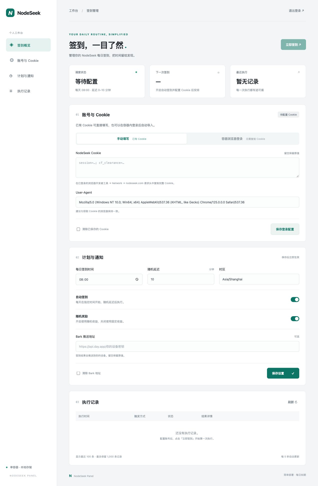

# NodeSeek Panel

一个容器完成 NodeSeek 每日签到、网页管理和可视化登录。支持手动粘贴 Cookie，或在容器浏览器里亲自登录后自动导入 Cookie 与 User-Agent。

- 中文管理面板：密码登录、每日定时、随机延迟、随机/固定奖励、立即签到。
- 两种登录方式：传统 Cookie 填写；内置 Chromium + noVNC 可视化登录，无需复制 Cookie。
- Bark 结果通知；最近 100 条可见记录，最多保留 1,000 条。
- `/data` 持久化配置、任务计划、执行记录和登录密钥；重启不丢配置。
- 一个容器、一个对外端口 `8080`，不需要 Redis、数据库容器或独立浏览器服务。
- `linux/amd64` / `linux/arm64` 镜像，适用于常见服务器、NAS 和 Apple Silicon。

镜像：`ghcr.io/dongbo501/nodeseek-panel:latest`

源码：[dongbo501/nodeseek-panel](https://github.com/dongbo501/nodeseek-panel)



## 快速部署

需要 Docker Engine 和 Docker Compose v2。建议至少 1 GB 可用内存；打开浏览器时建议预留 2 GB。内置浏览器会使镜像明显大于纯 Python 镜像，但仅在登录期间启动浏览器进程。

```bash
git clone https://github.com/dongbo501/nodeseek-panel.git
cd nodeseek-panel
cp .env.example .env
```

编辑 `.env`，设置自己的管理密码（至少 12 位）：

```dotenv
ADMIN_PASSWORD=这里替换为至少12位的独立强密码
BIND_ADDRESS=127.0.0.1
PORT=8080
COOKIE_SECURE=false
```

```bash
docker compose pull
docker compose up -d
```

访问 **http://127.0.0.1:8080**，使用 `.env` 中的密码登录。默认只允许本机访问。远程服务器可使用 SSH 转发：

```bash
ssh -L 8080:127.0.0.1:8080 user@your-server
```

然后在自己的电脑打开同一地址。需要局域网访问时，将 `BIND_ADDRESS` 改成 `0.0.0.0` 并重新 `docker compose up -d`，通过 `http://服务器IP:8080` 访问；公网请配合 HTTPS 反向代理和防火墙，配置示例见 [部署教程](docs/DEPLOY.md)。

### 不使用 Compose

```bash
docker run -d --name nodeseek-panel --restart unless-stopped \
  -p 127.0.0.1:8080:8080 \
  --shm-size=512m \
  --cap-drop=ALL --security-opt=no-new-privileges:true \
  -v nodeseek-data:/data \
  ghcr.io/dongbo501/nodeseek-panel:latest

docker logs nodeseek-panel
```

未设置 `ADMIN_PASSWORD` 时首次启动自动生成管理密码，仅在容器日志中显示一次，密码哈希保存在数据卷中。也可以使用 `--env-file .env` 指定密码。管理员密码与 NodeSeek 账号密码相互独立。

## 配置账号：两种方式

### 方式一：从已有浏览器复制 Cookie

1. 在自己的浏览器中登录 [NodeSeek](https://www.nodeseek.com)。
2. 打开开发者工具（通常是 F12），进入 **Network / 网络**。
3. 刷新页面，选择发往 `www.nodeseek.com` 的请求。
4. 在 **Request Headers / 请求标头** 中复制完整的 `Cookie` 值，例如 `session=...; cf_clearance=...`，不要包含前面的 `Cookie:`。
5. 打开管理面板的 **账号与 Cookie → 手动填写**，粘贴 Cookie；将 `User-Agent` 设置为同一请求的 User-Agent，保存。
6. 点击 **立即签到**，在执行记录中查看结果。

Cookie 输入框保存后会清空，再次提交空值表示保留原值；只有勾选清除选项才会删除。Cookie 不会由 API 明文返回。

### 方式二：在容器浏览器中手工登录

1. 打开 **账号与 Cookie → 容器浏览器登录**。
2. 点击 **打开登录浏览器**，等待嵌入式浏览器连接。
3. 在浏览器里亲自登录 NodeSeek，出现验证码时自行完成。
4. 检测到 NodeSeek 的 `session` Cookie 后，面板自动读取该站点 Cookie（包括 HttpOnly Cookie）和浏览器的 User-Agent，保存到配置。
5. 导入完成后浏览器自动关闭，临时浏览器资料被清理。面板显示成功提示后，可以点击 **立即签到**验证有效性。
6. 若登录后尚未自动导入，可点击 **已登录，立即读取**。10 分钟未完成的会话会自动关闭，可重新开启。

这条路径不需要把 NodeSeek 密码填入管理面板表单。密码只在浏览器的站点登录页面输入，不被程序主动采集；浏览器禁用密码保存。远程画面与控制通过经过管理登录验证的 WebSocket 传输，VNC 和浏览器调试端口不对外发布。

**登录后抓到 Cookie 不等于网站一定接受签到请求。** Cloudflare 可能把验证绑定到出口 IP、浏览器或 TLS 特征；本项目使用 Python 发起签到请求，不承诺绕过站点防护。出现 403 时可在容器浏览器重新登录并验证，仍失败则检查出口网络或站点策略。不要关闭证书验证。

## 计划、执行与通知

- 默认时区 `Asia/Shanghai`，每天 `08:00` 起随机延迟 `0～10` 分钟。
- 在 **计划与通知** 中修改时间、时区、随机延迟、自动签到开关及奖励方式；保存后立即生效。
- 首次配置或修改计划时，如果今天的开始时间已过，则安排到明天。
- 已持久化的任务因重启延迟：当天尚未执行的任务会补执行；跨天过期任务跳过，不批量补签。
- 调度器领取任务后先持久化下一次计划，再开始执行，避免重启反复领取；执行过程中异常退出的任务标为结果未知，不自动重复提交。
- 手动签到不改变每日计划。已有任务运行时拒绝重复启动；关闭自动签到仍允许手动执行。
- 网络异常/临时服务错误最多尝试 3 次，间隔 60 秒；Cookie 失效或 Cloudflare 拒绝会提示更新。
- 可填写 Bark 地址 `https://api.day.app/你的设备密钥`，结果自动推送。也支持自建 HTTPS Bark；推送失败不会把签到成功改为失败。
- 可使用 `NODESEEK_COOKIE` 环境变量覆盖存储配置；此时面板禁用 Cookie 编辑和浏览器导入。通常建议直接使用面板管理。

## 从原 Python 脚本迁移

保留原 `config.json`，其中可能包含真实 Cookie 和 Bark 密钥，**不要提交到 GitHub**。

先启动一次容器，再停止并复制配置：

```bash
docker compose stop
docker cp ./config.json nodeseek-panel:/data/config.json
docker compose run --rm --user 0 --entrypoint sh nodeseek \
  -c 'chown 10001:10001 /data/config.json && chmod 600 /data/config.json'
docker compose up -d
```

兼容原字段 `cookie`、`random`、`run_at`、`jitter_minutes`、`user_agent`、`bark_url`。新字段会使用默认值。迁移后请停止旧脚本或旧 cron 任务，避免重复运行。

原脚本仍可单独运行（Python 标准库，不需要网页依赖）：

```bash
cp config.example.json config.json
# 编辑 config.json
python3 nodeseek_signin.py --once --no-delay
```

## 更新、备份和排错

```bash
# 更新镜像并重建容器，命名卷数据不变
docker compose pull
docker compose up -d

# 状态与日志
docker compose ps
docker compose logs --tail=100 -f

# 停止服务（保留数据）
docker compose down
```

备份/恢复、HTTPS/WebSocket 代理、NAS 目录权限和密码重置见 **[完整部署与维护教程](docs/DEPLOY.md)**。

## 本地构建与测试

```bash
docker compose build
docker compose up -d --no-build

# Python 3.12 推荐；测试不访问 NodeSeek，不使用你的真实 Cookie
python3 -m venv .venv
. .venv/bin/activate
pip install -r requirements.txt
python -m unittest discover -s tests -v
```

开发时也可运行 `DATA_DIR=./data ADMIN_PASSWORD=你的12位以上密码 python -m panel`；容器浏览器功能需要 Linux 上安装 Chromium、Xvfb、x11vnc、noVNC，推荐直接用 Docker 测试。

代码结构：`nodeseek_signin.py` 为签到核心；`panel/web.py` 为网页 API 和鉴权；`panel/service.py` 为调度与历史；`panel/browser.py` 为临时浏览器与 Cookie 导入；`panel/static/` 与 `panel/templates/` 为前端。

仓库的 GitHub Actions 会先运行测试，再分别在 amd64 和 arm64 原生机器上构建并运行真实浏览器集成测试，两边通过后才发布多架构镜像。推送 `main` 更新 `latest` 与提交 SHA 标签，推送 `v*` 标签产生版本标签。Fork 后镜像名自动采用自己的仓库路径。首次发布 GHCR 包需设为 Public，才能无需登录拉取。

## 数据与边界

- 单管理员、单 NodeSeek 账号，按自己的需要部署多个容器即可管理多个账号。
- 仅开放 `8080`；以 UID/GID `10001` 非 root 用户运行。不要增加 worker 数量，否则会重复调度。
- Cookie、Bark 密钥以文件方式保存在 `/data/config.json`（权限 `0600`），不是加密存储。保护数据卷和备份文件；API 隐藏敏感字段，执行消息会做脱敏。
- 面板包含密码哈希、HttpOnly / SameSite 会话、CSRF 验证、登录频率限制。公网使用 HTTPS，并设置 `COOKIE_SECURE=true`。
- Chromium 使用容器内非 root 模式和 `--no-sandbox`；容器保留 Docker 默认隔离，Compose 移除额外能力并启用 `no-new-privileges`。可视化浏览器仅用于你信任的 NodeSeek 登录，不用作通用共享浏览器。
- Cookie/浏览器临时文件、`.env`、数据库和日志通过 `.gitignore` 排除；Docker 构建采用允许列表，只复制程序和依赖文件。
- 与 NodeSeek 官方无关联。请遵守站点规则，勿用于批量账号或滥用。
